# 🛡️ Digital Crime Scene Reconstruction Engine (DCSRE)
### *አሻራ (Ashara) — Advanced Cyber Forensics & Incident Reconstruction Platform*

[](https://fastapi.tiangolo.com)
[](https://reactjs.org)
[](https://www.typescriptlang.org)
[](https://www.python.org)
[](https://attack.mitre.org)
[](https://tailwindcss.com)
[](https://www.docker.com)
[](LICENSE)

---

## 📽️ 1. Video Presentation

> [!NOTE]
> ### Technical Video Demonstrations
> **End-to-End System Walkthrough, Forensic Reconstruction Pipeline, and Backend Architecture**
> 
> * 🎥 **System Demonstration & Forensic Reconstruction**: [Watch 5-Minute Project Video](https://www.awesomescreenshot.com/video/57769375?key=c9aa18ff075c78c7a647b175a7febd6d)

> * **Coverage**: Evidence ingestion, multi-source log normalization, deterministic MITRE ATT&CK correlation, interactive attack path graph traversal, and courtroom-ready report generation.

---

## 👥 2. Team Information

| # | Full Name | CTC ID |
|---|:---|:---|:---|
| 1 | **Bitaniya Damtew** | `CTC-2894-26` |  
| 2 | **Sarendem Worku** | `CTC-2672-26` |  
| 3 | **Lidya Nigusse** | `CTC-1145-26` | 
| 4 | **Henon Chare** | `CTC-077-26` |
| 5 | **Zulkifl Seid** | `CTC-1083-26` | 
| 6 | **Zelalem Tsegaye** | `CTC-2003-26` |

---

## 📖 3. Project Information

### 3.1 Overview
The **Digital Crime Scene Reconstruction Engine (DCSRE)** — codenamed **አሻራ (Ashara)** — is a state-of-the-art **Digital Forensics and Incident Response (DFIR)** platform designed to ingest raw, heterogeneous digital artifacts, reconstruct the exact chronological sequence of an attack, visualize entity traversal across network topologies, and compile court-admissible forensic reports.

In real-world security breaches, investigators must analyze hundreds of thousands of fragmented, vendor-specific logs (Windows Event Logs, Linux auth/audit logs, PCAP captures, web server logs). Manual correlation is tedious, slow, and prone to investigator bias. **DCSRE transforms raw forensic telemetry into a single, verifiable, deterministic reconstruction of the cyber crime scene.**

### 3.2 Key Features

* **🔒 Cryptographic Evidence Custody**: Computes in-browser and server-side SHA-256 fingerprints upon ingestion, guaranteeing an unbroken chain of custody per NIST SP 800-86 standards.
* **⚡ Multi-Format Forensic Ingestion**: Automated heuristic parsers for Windows EVTX/Sysmon, PCAP network captures, Linux Syslog/`auth.log`, Auditd, Apache/Nginx web logs, CSV, and JSON.
* **🌐 Common Event Schema (CES) Normalization**: Converts disparate log formats into a canonical schema capturing timestamp (UTC ISO-8601), actor, target host, source/destination IPs and ports, user, process, and outcome.
* **🎯 Deterministic Threat Detection Engine**: Rigorous, deterministic Sigma-style rule execution mapped against the **MITRE ATT&CK** taxonomy without relying on non-deterministic black-box guessing.
* **⏱️ Unified Chronological Timeline**: High-resolution event interleaving across endpoints, servers, and perimeter firewalls to uncover precise attack sequences.
* **🕸️ Interactive Attack Path & Topological Graph**: Visual 2D and 3D node-and-edge graph mapping compromised hosts, adversary infrastructure, pivot points, and data exfiltration paths.
* **📄 Self-Verifying Forensic Reports**: Generates formal examination reports featuring an executive summary, chronological incident sequence, IOC lists, and a content-derived SHA-256 seal.
* **🛡️ Role-Based Access Control (RBAC)**: Distinct permissions for System Administrators, Lead Forensics Investigators.

---

## 🏛️ 4. System Architecture & Pipeline

DCSRE processes evidence through an 8-stage deterministic pipeline:

```
┌────────────────────────────────────────────────────────────────────────┐
│                       EVIDENTIARY ARTIFACTS                            │
│  [ Windows EVTX ]   [ Linux auth.log ]   [ PCAP captures ]   [ Nginx ] │
└──────────────────────────────────┬─────────────────────────────────────┘
                                   │
                                   ▼
┌────────────────────────────────────────────────────────────────────────┐
│ STAGE 1: Evidence Ingestion & Cryptographic SHA-256 Fingerprinting     │
├────────────────────────────────────────────────────────────────────────┤
│ STAGE 2: Multi-Format Parser Dispatch & Canonical Event Normalization  │
├────────────────────────────────────────────────────────────────────────┤
│ STAGE 3: Unified Chronological Timeline Reconstruction                 │
├────────────────────────────────────────────────────────────────────────┤
│ STAGE 4: Sigma Rule Field Matching & Taxonomy Mapping                  │
├────────────────────────────────────────────────────────────────────────┤
│ STAGE 5: Deterministic Detection Engine (MITRE ATT&CK TTPs)            │
├────────────────────────────────────────────────────────────────────────┤
│ STAGE 6: Entity Role Classification (Compromised Host / Adversary C2)   │
├────────────────────────────────────────────────────────────────────────┤
│ STAGE 7: Attack Graph & Topological Path Reconstruction                │
├────────────────────────────────────────────────────────────────────────┤
│ STAGE 8: Forensic Incident Report Generation with SHA-256 Seal         │
└──────────────────────────────────┬─────────────────────────────────────┘
                                   │
                                   ▼
┌────────────────────────────────────────────────────────────────────────┐
│                   INVESTIGATOR WORKSPACE & DASHBOARD                   │
│   [ Timeline View ]    [ Attack Graph ]    [ PDF Report ]   [ Audit ]  │
└────────────────────────────────────────────────────────────────────────┘
```

---

## 📸 5. Proof of Working System (Live Deployment & Visual Walkthrough)

> [!TIP]
> ### 🌐 Live Deployed Application Links
> * 🔗 **Live Web Application (Frontend)**: [https://digital-crime-scene-reconstruction-three.vercel.app/](https://digital-crime-scene-reconstruction-three.vercel.app/)
> * ⚙️ **Backend Architecture & API Demo**: [Watch Backend Demonstration Video](https://www.awesomescreenshot.com/video/57761370?key=0ca455075891fd2ab94560c28127f4c1)
---


#### 5.1 Public Portal & 3D Global Cyber Threat Sphere
*Landing page showing real-time incident metrics and interactive 3D attack topology.*

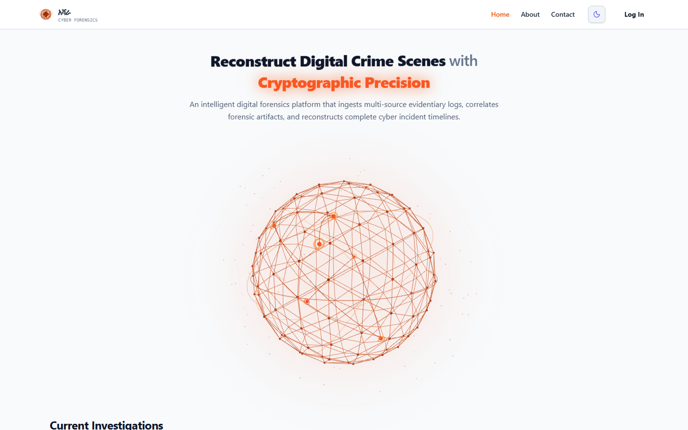

---

#### 5.2 Role-Based Authentication & Session Security
*Enterprise authentication supporting RBAC boundaries (Admin, Lead Investigator).*

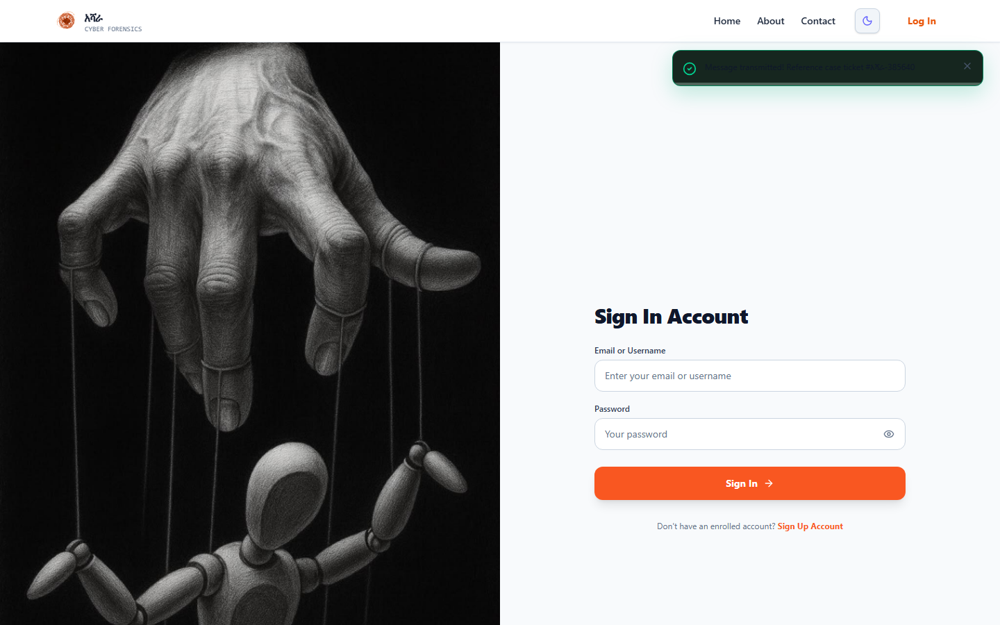

---

#### 5.3 Forensic Investigator Dashboard
*Unified command center with active case telemetry, compliance scoring, and gateway density metrics.*

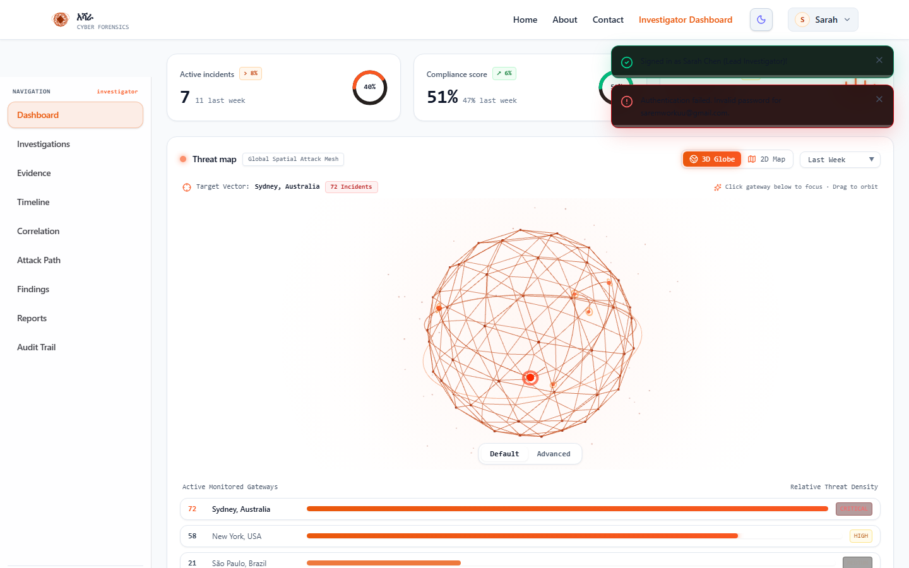

---

#### 5.4 Centralized Case Management
*Workspace for creating, tracking, assigning, and archiving digital forensics investigations.*

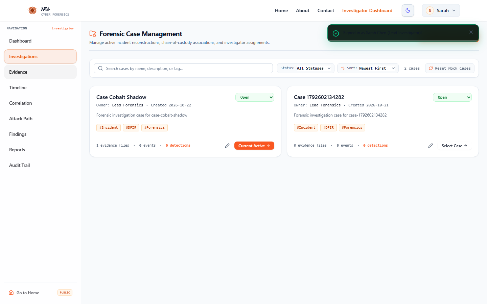

---

#### 5.5 Evidence Ingestion Vault & Cryptographic Custody Inventory
*Dropzone validator featuring auto-detect parsers and automatic SHA-256 integrity verification.*

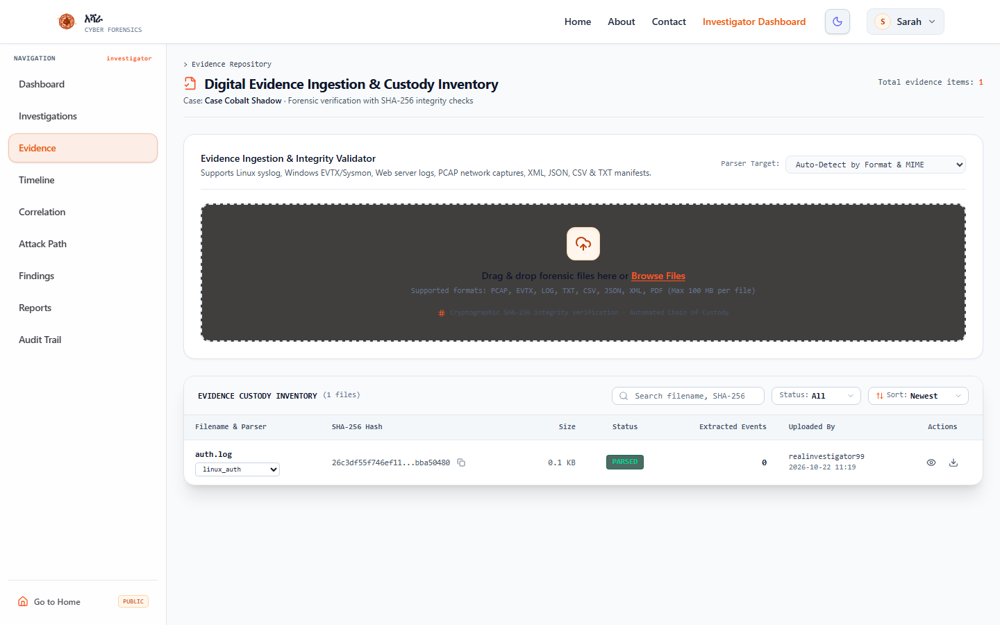

---

#### 5.6 Chronological Incident Timeline Reconstruction
*UTC-normalized microsecond event sequence interleaving actions across multi-host environments.*

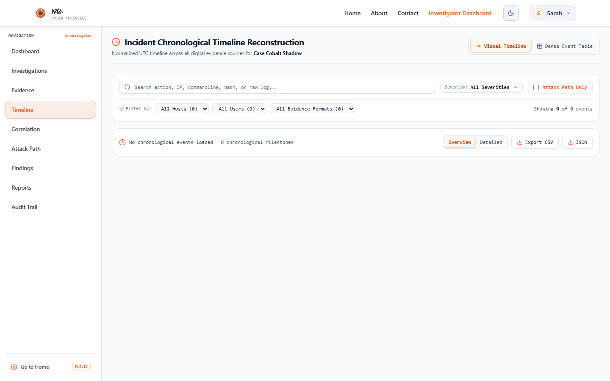

---

#### 5.7 Attack Path & Entity Relationship Topology
*Interactive 2D graph reconstructing adversary lateral movement, privilege escalation, and external C2 communication.*

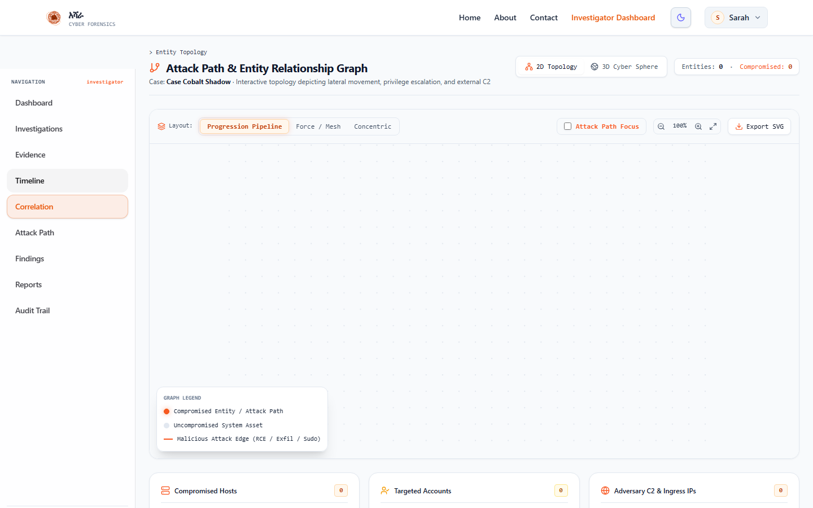

---

#### 5.8 Adversary Attack Path Trajectory (Kill-Chain Sequence)
*Chronological kill-chain hops, lateral movement progression, and adversary dwell time analysis.*

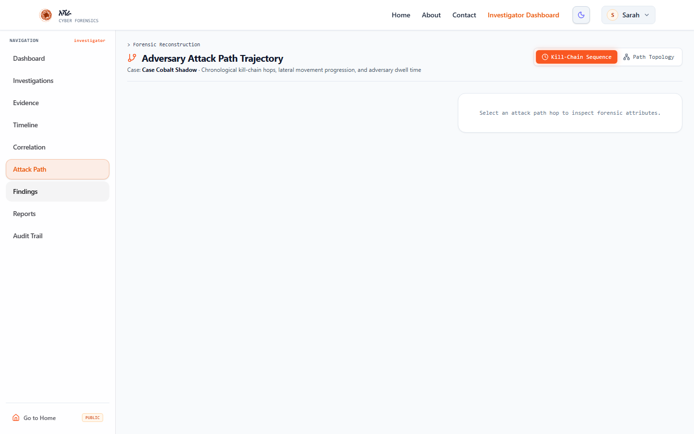

---

#### 5.9 Deterministic Findings & Threat Detections
*Rules evaluation engine correlating events to MITRE ATT&CK tactics with full traceability to raw event IDs.*

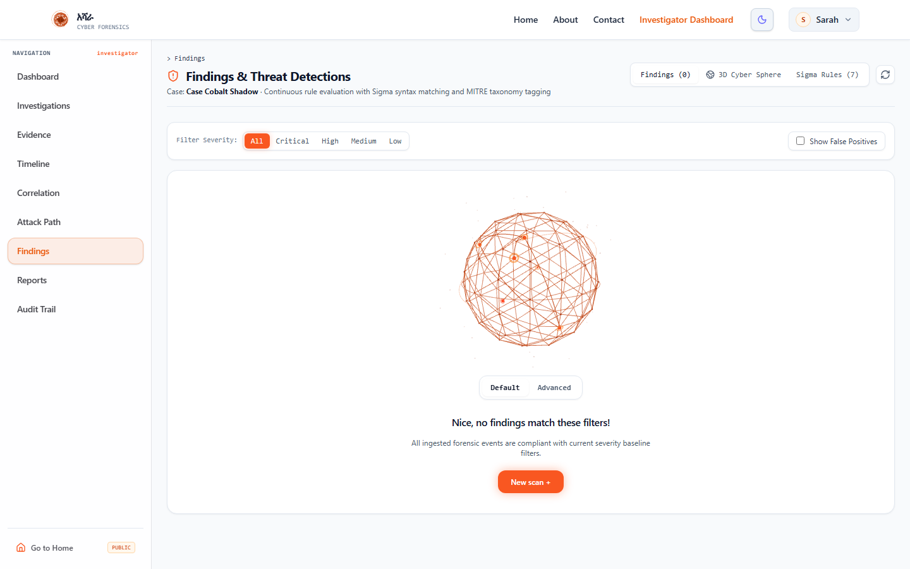

---

#### 5.10 Courtroom-Ready Forensic Incident Report
*Automatically generated report with executive summary, evidence custody log, and a cryptographic integrity seal.*

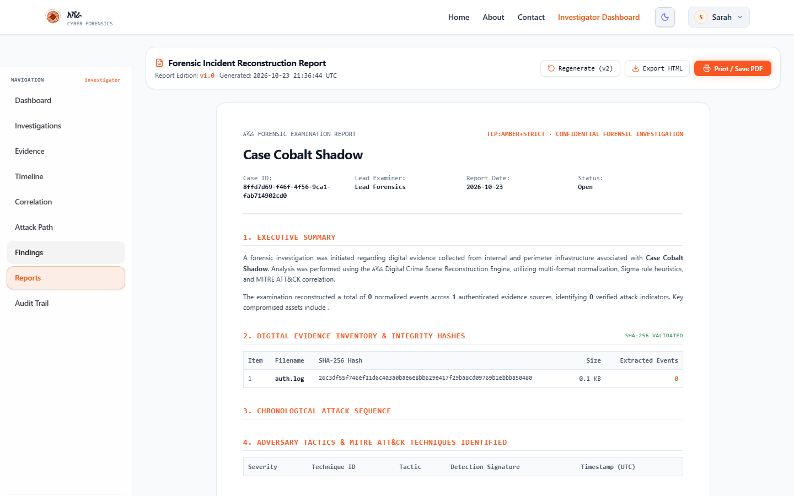

---

#### 5.11 System Health & Ingestion Pipeline Telemetry
*Real-time performance metrics showing parser status, average parsing latency, storage quotas, and background worker queues.*

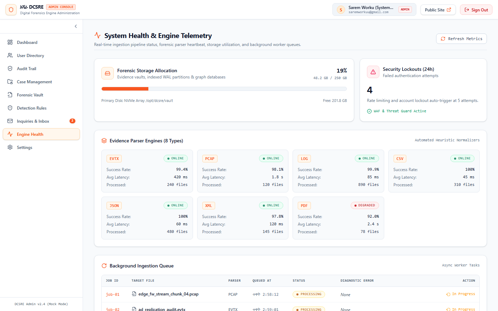

## 🚀 6. Quick Start & Installation

### 6.1 Prerequisites
* **Python**: 3.11 or higher
* **Node.js**: v18 or higher (v20+ recommended)
* **PostgreSQL** or **SQLite**: (PostgreSQL recommended for production)

### 6.2 Running the Backend
```bash
# Navigate to backend directory
cd backend

# Create and activate virtual environment
python -m venv venv
# On Windows:
.\venv\Scripts\activate
# On Linux/macOS:
source venv/bin/activate

# Install dependencies
pip install -r requirements.txt

# Configure environment variables
copy .env.example .env

# Launch FastAPI server with hot-reload
uvicorn app.main:app --reload --host 0.0.0.0 --port 8000
```
Backend API interactive Swagger docs available at: **http://localhost:8000/docs**

### 6.3 Running the Frontend
```bash
# Navigate to frontend directory
cd frontend

# Install dependencies
npm install

# Start Vite development server
npm run dev
```
Open your browser at: **http://localhost:3000** (or **http://localhost:3001**)

### 6.4 Default Credentials for Testing
| Account Role | Email / Username | Password |
|---|---|---|
| **System Administrator** | `saremworkuu@gmail.com` | `Admin@2026!` |
| **Lead Investigator** | `investigator@dcsre.corp` | `Investigator#2026` |

---

## 🗄️ 7. Supported Forensic Artifact Formats

| Format | File Types | Forensic Data Extracted |
|---|---|---|
| **Windows Event Logs** | `.evtx`, `.xml` | Logon sessions (Event 4624/4625), process creation (Event 4688/Sysmon 1), service installs (7045), PowerShell script blocks (4104) |
| **Network Captures** | `.pcap`, `.pcapng` | TCP/UDP session flows, DNS query payloads, HTTP requests, exfiltration volumes |
| **Linux System Logs** | `auth.log`, `syslog`, `secure` | SSH brute force attempts, sudo privilege escalation, user creations, pam sessions |
| **Linux Audit Logs** | `audit.log`, `auditd` | SYSCALL executions, file permission modifications, user namespace alterations |
| **Web Server Logs** | `access.log` (Nginx, Apache) | SQL injection probes, web shell uploads, scanner User-Agents, LFI/RFI traversal |
| **Generic Text / Tables** | `.csv`, `.json`, `.txt` | Custom SIEM exports, triage timelines, endpoint activity manifests |

---

## ⚖️ 8. Forensic Integrity & Legal Admissibility

1. **Strict Determinism**: Zero artificial hallucination. All conclusions, entity classifications, and findings are directly traceable to specific source artifact records.
2. **Chain of Custody Preservation**: Uploaded files receive immediate cryptographic SHA-256 fingerprinting that is permanently logged and cited throughout subsequent reports.
3. **Defense-in-Depth RBAC**: Strict role enforcement preventing unauthorized access, deletion, or tampering with active investigation cases.

---

## 📄 License
This project is licensed under the MIT License — see the [LICENSE](LICENSE) file for details.
